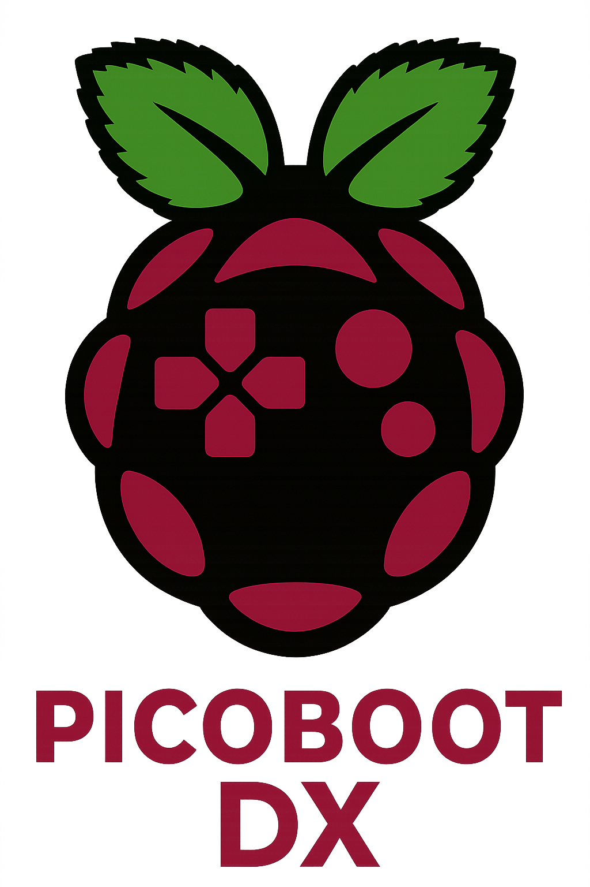

# PicoBoot-WiFi

PicoBoot-DX for the Raspberry Pi **Pico 2 W**, with updates over Wi-Fi. It's a GameCube IPL-injection modchip: at power-on it boots the homebrew of your choice (Swiss, gekkoboot, …). Once the console has started, it runs a Wi-Fi access point. There a phone or computer can update its payloads and its own firmware, change settings and make backups, without opening the console.

**How it relates to PicoBoot-DX:** the injection itself (PicoBoot's PIO programs, as PicoBoot-DX has them) and the payload format carry over nearly unchanged. Everything around them is new: a loader with two firmware slots, the Wi-Fi access point and its page, the API and the command-line tool, and the updates over Wi-Fi.

## What it does

- **Boots a payload at every power-on:** payload 1, payload 2, or the built-in gekkoboot. It takes the same payloads as PicoBoot and PicoBoot-DX: `swiss_rXXXX.uf2`, `gekkoboot_pico.uf2`, or a `.dol` built as an IPL replacement.
- **A Wi-Fi access point after the injection:** `PicoBoot-XXXX`, where `XXXX` is from the chip's ID. Phones open its page by themselves; otherwise go to `http://192.168.4.1/`. It turns off 10 minutes after the last client leaves.
- **Payloads over Wi-Fi:**
  - upload a `.dol`, a payload `.uf2` or a raw payload; it goes into the slot that isn't chosen;
  - choose what boots next, rename, delete, and download a backup;
  - **Original IPL once:** the next power-on starts the console's own menu, to set the clock or the language.
- **Firmware updates over Wi-Fi:** an update goes into the other firmware slot and starts on trial. If it doesn't work, PicoBoot-WiFi goes back to the previous firmware by itself.
- **Settings and diagnostics:** the Wi-Fi name, password, country, channel and transmit power, auto-off, and the LED. A boot log shows each power-on's injection and its timing margin.
- **A running game is never disturbed:** a reboot of the Pico without a power cycle doesn't inject again.
- **A command-line tool** does the same from a computer: [`tools/picoboot-wifi.py`](tools/picoboot-wifi.py).

## What you need

- **A Raspberry Pi Pico 2 W.** No other board: the updates over Wi-Fi need the Pico 2 W's flash layout and radio. For other boards, use [PicoBoot-DX](https://github.com/r3mko/PicoBoot-DX).
- **A GameCube DOL-001.** That's the model it's tested on. The DOL-101 should work too (it boots the IPL the same way, as with PicoBoot), but it hasn't been tested.
- **Five wires, soldered as for PicoBoot.**

## Wiring

The wiring is PicoBoot's (since its v0.4): see the wiring diagram in [PicoBoot's README](https://github.com/webhdx/PicoBoot#installation) and its [installation guide](https://support.webhdx.dev/gc/picoboot/installation-guide). On the Pico side:

| Pico 2 W | Signal |
|---|---|
| GP4 | CS (chip select of the IPL chip, U10) |
| GP5 | CLK (EXI clock) |
| GP6 | Data |
| GND | Ground |
| VSYS (with 5 V) or 3V3 | Power, see below |

**Power: 5 V is recommended.** Wire the console's 5 V through a Schottky diode (e.g. 1N5819, SS110) to VSYS. The Pico's own regulator then powers the Wi-Fi chip. With the 3V3 wiring, the console's 3.3 V rail powers the radio as well: on the test console it measured 3.15 V with the radio on, below the 3.2 V where the Wi-Fi chip guarantees full radio performance. The 3V3 wiring still works, and it's supported. Use one of the two, not both.

An existing PicoBoot or PicoBoot-DX installation keeps its wiring.

## Installing

1. Download `picoboot-wifi-X.Y.Z.uf2` from the [releases](../../releases).
2. With the console off, hold the Pico's BOOTSEL button while you connect it to a computer over USB. A drive named `RP2350` appears.
3. Copy the `.uf2` onto that drive. The Pico writes it and restarts.
4. Unplug USB and switch the console on.

**Payloads after the install:**
- **The payload area isn't touched:** a payload installed earlier, e.g. by PicoBoot-DX, stays as payload 1 and keeps booting.
- **With no payload,** the built-in gekkoboot boots.
- **To add one over Wi-Fi,** upload it on the Payloads tab.
- **To add one over USB,** copy a PicoBoot payload UF2 onto the Pico's drive the same way, e.g. `swiss_rXXXX.uf2` from the `PicoBoot` folder of a Swiss release. It goes into payload 1 and boots at the next power-on, whatever was chosen before. gekkoboot's `gekkoboot_pico.uf2` holds RP2040 blocks only, which the Pico 2 ignores over USB: upload it over Wi-Fi instead, where any UF2 is taken.

## Upgrading from PicoBoot-DX

Install `picoboot-wifi-X.Y.Z.uf2` as above. The wiring stays the same, and the payload PicoBoot-DX booted stays in place as payload 1. To go back, install PicoBoot-DX's UF2 the same way: it finds the payload where it left it.

## Using it

1. **Join the access point:** `PicoBoot-XXXX`, password **`picoboot`**. It comes up within about two seconds of switching the console on, once the payload is in.
2. **Change the password** on the Settings tab. A banner reminds you until you do. The Wi-Fi password is the only protection: anyone who knows it can change the firmware and the payloads.
3. **The Wi-Fi turns off** 10 minutes after the last client leaves (Settings: 2, 5, 10 or 30 minutes, or always on). Switch the console off and on to bring it back.

**The tabs:**
- **Payloads:**
  - **Upload:** a `.dol`, a payload `.uf2` (from any Pico family) or a raw payload. It goes into the slot that isn't chosen, replacing what's there, and boots at the next power-on.
  - **Per payload:** choose it, rename it, delete it (not the chosen one), or download a backup.
  - **Built-in gekkoboot:** it can be chosen as well. It also boots when the chosen payload isn't valid.
  - **Original IPL once:** the next power-on starts the console's own menu; the one after boots the payload again.
  - **`.dol` files:** only those built as an IPL replacement work, i.e. loaded at `0x81300000`, such as gekkoboot or iplboot. Swiss ships its IPL payload only in `PicoBoot/swiss_rXXXX.uf2`, so use that; a regular `swiss_rXXXX.dol` is refused.
- **Firmware:**
  - **Install an update** (`picoboot-wifi-X.Y.Z-update.bin`): it goes into the other slot and starts on trial.
  - **Keeping it:** it's kept by itself after the next power-on with a complete injection, or press *Keep*. If it crashes on trial, or its Wi-Fi doesn't come up, the previous firmware boots again by itself.
  - **Later crashes:** a kept firmware that crashes three times in a row gives way to the other kept one.
  - **Older versions** can be installed too, with a warning.
  - Also: switch slots, or download a backup of the running firmware.
- **Settings:** the Wi-Fi name and password, the country, channel and transmit power, auto-off, the LED, a backup and restore of the settings (without the password), and a reboot.
- **Diagnostics:** this boot, the injection's margin, and the boot log.

**The LED:**
- dark during the injection;
- three slow blinks once it completed;
- fast blinks if it stalled;
- then on while the Wi-Fi is on.

The Settings tab can turn it off.

## Command line

`tools/picoboot-wifi.py` needs only Python 3, and works when copied on its own. Join the access point first.

```sh
python3 picoboot-wifi.py status
python3 picoboot-wifi.py payload upload swiss_r2119.uf2        # or a .dol, or a raw payload
python3 picoboot-wifi.py payload choose payload1|payload2|builtin
python3 picoboot-wifi.py payload rename payload1 "Swiss r2119"
python3 picoboot-wifi.py payload delete payload2
python3 picoboot-wifi.py payload convert gekkoboot.dol [--uf2] # .dol → raw payload, or a UF2 for USB; no Pico needed
python3 picoboot-wifi.py ipl-once [--off]
python3 picoboot-wifi.py update picoboot-wifi-X.Y.Z-update.bin
python3 picoboot-wifi.py keep
python3 picoboot-wifi.py boot A|B
python3 picoboot-wifi.py backup payload1|payload2|firmware|settings
python3 picoboot-wifi.py restore-settings picoboot-wifi-settings.json
python3 picoboot-wifi.py reboot
```

The JSON API is described in [docs/api.md](docs/api.md).

## Security

- **The Wi-Fi password is the only gate.** There's no separate login, and update files aren't signed. Anyone who has the password can install any firmware, and a hostile firmware could even write the chip's one-time-programmable memory, which no USB reinstall undoes. Change the default password, and install only files from this project's releases.
- **WPA2-AES,** and plain HTTP on the access point.
- **A web page elsewhere can't change anything on PicoBoot-WiFi,** but one left open while a phone joins its Wi-Fi could read what the page shows: the status, the settings without the password, the diagnostics and the backups.

## Recovery

| Problem | What to do |
|---|---|
| Forgotten Wi-Fi password, or settings that lock you out | Install `picoboot-wifi-X.Y.Z.uf2` again over USB. It resets the settings (the default password), the payload choice and the names, and leaves the payloads |
| A firmware update that doesn't work | Nothing: on trial, its first crash brings the previous firmware back by itself. Or boot the other slot on the Firmware tab |
| A payload that doesn't boot | Choose another payload or the built-in gekkoboot, or set *Original IPL once* |
| The console starts its own menu instead of the payload | The Diagnostics tab shows the last boot's injection result. "No console seen" or "stalled" points at the wiring; check CS, CLK and Data |
| No Wi-Fi | Switch the console off and on: the Wi-Fi turns off 10 minutes after the last client, by default |

## Documentation

- [Design](docs/architecture.md): the decisions, flash layout, boot flow and update model.
- [Implementation plan](docs/implementation-plan.md): the phases, their steps and how they were built.
- [JSON API](docs/api.md) and [update file format](docs/update-format.md).
- [Research](docs/research/README.md), with the hardware results of each phase.

## Building

Everything builds in Docker, with the same SDK and toolchain as CI (Pico SDK 2.3.1, picotool 2.3.1, arm-none-eabi-gcc 14.2):

```sh
docker build -t picoboot-wifi-build docker/
docker run --rm -v "$PWD":/src -w /src picoboot-wifi-build \
    sh -c 'cmake -S . -B build -DCMAKE_BUILD_TYPE=Release && cmake --build build --parallel'
PICOBOOT_BUILD_DIR=build python3 -m unittest discover -s tests -v
docker run --rm -v "$PWD":/src -w /src picoboot-wifi-build \
    python3 tests/check_layout.py --loader build/src/loader/loader.elf --firmware build/src/firmware/firmware.elf
```

The build writes `build/picoboot-wifi-install.uf2` (the USB install) and `build/picoboot-wifi-update.bin` (the update file). A version ending in `-dev` (`CMakeLists.txt`) makes a test build, with a test page at `http://192.168.4.1/test`. The tests need a C compiler for the host tests and, for the `.dol` converter's test, Node.js; they skip what they can't run.

## License

GPL-2.0-only (see [LICENSE](LICENSE)). PicoBoot-WiFi builds on [PicoBoot-DX](https://github.com/r3mko/PicoBoot-DX) and [PicoBoot](https://github.com/webhdx/PicoBoot) by Maciej Kobus, and bundles [gekkoboot](https://github.com/redolution/gekkoboot).
